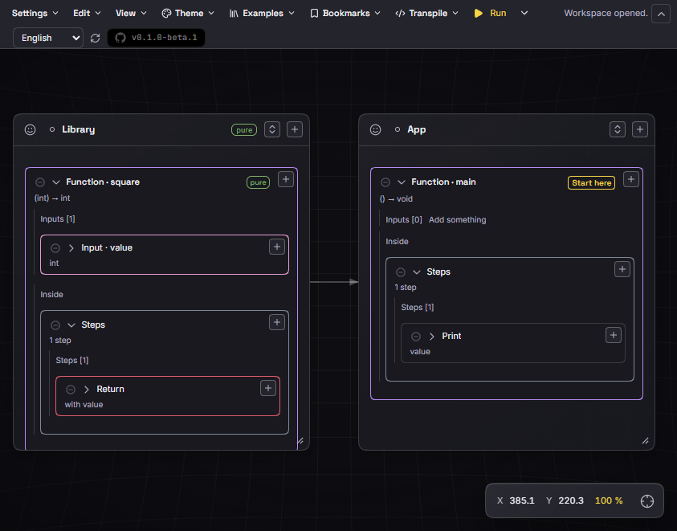

# Sapphire 3



Application **desktop Windows, Linux et macOS** de programmation visuelle, en bêta (`0.1.0-beta.8`). Chaque carte posée sur le canvas est une construction d'un langage typé, analysée par un moteur JavaScript pur et indépendant des langages cibles. Le texte reste possible, mais il n'est plus le point de départ.

**Voir les exemples en ligne : [dashboards interactifs](https://lalbi94.github.io/Sapphire3/visual/dashboards.html)** — douze dashboards autonomes générés depuis les exemples locaux.

**Site public : [accueil, téléchargement, dashboards et documentation](https://lalbi94.github.io/Sapphire3/visual/)** — vitrine séparée de la documentation détaillée, avec recherche locale, huit langues (anglais par défaut, choix mémorisé, RTL arabe) et animations respectant la réduction du mouvement.

## Installation et démarrage

Pour un poste Windows sans Node.js, utilisez l’**installateur** `Sapphire3-<version>-windows-setup.exe` (installation par utilisateur, sans droit administrateur) ou le **ZIP portable**. Les deux contiennent la même application ; l’installateur ajoute les raccourcis et la désinstallation. Tant qu’aucun certificat de signature n’est configuré, le paquet est explicitement non signé.

Pour Linux, utilisez `Sapphire3-<version>-linux-x64.tar.gz` ou `-linux-arm64.tar.gz`, puis lancez `./Sapphire3`. WebKitGTK 4.1 doit être disponible. Pour macOS, utilisez `Sapphire3-<version>-macos-universal.zip` et ouvrez `Sapphire 3.app` ; macOS 11 ou ultérieur est requis. Les paquets Linux et macOS sont compilés dans cette bêta mais **ne sont pas encore vérifiés à l’exécution** sur leur système cible ; ils ne sont ni signés ni notariés.

Pour développer :

Prérequis : Node.js compatible avec Vite 8 (22.12+ ou 24+), pnpm 11.5 et Windows avec WebView2.

```sh
pnpm install
pnpm desktop:setup
pnpm dev
```

`desktop:setup` télécharge le runtime Neutralinojs 6.10.0 dans `bin/` (ignoré par Git). `pnpm dev` démarre Vite et ouvre la fenêtre native avec rechargement à chaud.

## Commandes

- `pnpm dev:web` : frontend seul dans le navigateur, sur `http://127.0.0.1:5173`.
- `pnpm test` : tests Node et Python du moteur, du workspace, de la transpilation et du SDK.
- `pnpm --filter @sapphire3/core build` : construit le SDK `@sapphire3/core` dans `packages/core/dist/`.
- `pnpm sdk:pack` : construit et archive le SDK dans `build/sdk/`.
- `pnpm runtime:build` : construit le SDK `@sapphire3/runtime` dans `packages/runtime/dist/`.
- `pnpm runtime:test` : tests du runtime, y compris le packaging `npm pack`.
- `pnpm runtime:pack` : construit et archive le runtime dans `build/sdk/`.
- `pnpm transpiler:build` : construit le SDK `@sapphire3/Transpiler` dans `packages/transpiler/dist/`.
- `pnpm transpiler:test` : tests du transpiler, y compris le packaging `npm pack`.
- `pnpm transpiler:pack` : construit et archive le transpiler dans `build/sdk/`.
- `pnpm debug:build` : construit le SDK `@sapphire3/debug` dans `packages/debug/dist/`.
- `pnpm debug:test` : tests du débogueur, y compris le packaging `npm pack`.
- `pnpm debug:pack` : construit et archive le SDK debug dans `build/sdk/`.
- `pnpm project:build` : construit le SDK `@sapphire3/project` dans `packages/project/dist/`.
- `pnpm project:test` : tests du format workspace, du builder et du packaging.
- `pnpm project:pack` : construit et archive le SDK project dans `build/sdk/`.
- `pnpm graph:build` : construit le SDK `@sapphire3/graph` dans `packages/graph/dist/`.
- `pnpm graph:test` : tests des graphes, des analyses et des exports.
- `pnpm graph:pack` : construit et archive le SDK graph dans `build/sdk/`.
- `pnpm plugin:build` : construit le SDK `@sapphire3/plugin-sdk` dans `packages/plugin-sdk/dist/`.
- `pnpm plugin:test` : tests du SDK plugin, du cycle de vie, des widgets, des opérations natives, des composites et du packaging.
- `pnpm plugin:pack` : construit et archive le SDK plugin dans `build/sdk/`.
- `pnpm build` : compile le frontend dans `dist/`.
- `pnpm desktop:start` : compile puis ouvre le frontend compilé dans Neutralinojs, sans Vite.
- `pnpm dist:win` : construit le paquet portable Windows et son ZIP dans `build/release/`.
- `pnpm dist:linux` : construit les archives Linux x64 et ARM64.
- `pnpm dist:mac` : construit le bundle macOS universel.
- `pnpm dist:all` : construit les archives Windows, Linux et macOS.
- `pnpm dist:installer` : construit le ZIP puis l'installateur Windows (`ISCC.exe` requis).
- `pnpm docs:ast` : recompile le rapport LaTeX `abstract/ARCHITECTURE_AST.pdf`.
- `pnpm presence:build` : compile le sidecar Discord C++20 pour Windows, Linux et macOS (CMake 3.25+ et Zig 0.17+ requis à la construction).
- `pnpm presence:test` : compile et exécute les tests C++ du sidecar Discord via CMake.

La CI GitHub Actions (`.github/workflows/ci.yml`) exécute l’installation verrouillée, les contrôles de qualité, les tests et le build sur chaque pull request.

## Ce que l’application sait faire

### Canvas et compréhension visuelle
- Canvas plein écran navigable, zoom jusqu’à 400 %, quadrillage courbé, mini-carte et cadrage des modules.
- **Zoom sémantique** : instructions détaillées au-dessus de 21 %, liste des fonctions racines de 10 à 21 %, puis seules les cartes de modules et les relations intermodules à 10 % et moins.
- Modules, annotations **Comment** (avec formules KaTeX entre `$$ … $$`) et cartes **Image** intégrées localement.
- Cartes spéciales **Screen**, **Gauge**, **ProgressBar**, **LED** et **RGB LED**, adossées à des modules cachés normaux, avec aperçu ou code et lecture des images à 24 fps. La LED RVB expose trois canaux entiers 0–255 (`RGBLED_SP3_SET_COLOR`, `GET_RED`, `GET_GREEN`, `GET_BLUE`).
- **Boutons d’entrée** : **Widgets → Inputs** propose `toggleButton` et `holdButton`. Chaque carte lie une fonction du projet de signature `(boolean) -> void` depuis un volet **Configuration** pliable ; l’import et l’export sont créés automatiquement et la variable `onClick` reste visible dans la vue code. Le hold appelle la fonction une seule fois avec `true` à l’appui. Le toggle l’appelle immédiatement, puis toutes les 500 ms tant qu’il est actif, avec `false` au désactivation. Un clic démarre le live si nécessaire ; le dashboard exécute aussi la fonction liée. Les anciens boutons `isPress()` restent lisibles, et la transpilation est refusée (`TRANSPILE_INPUT_BUTTON_UNSUPPORTED`).
- **Presse-papiers système** : **Ctrl+C**, **Ctrl+X** et **Ctrl+V** copient, coupent et collent un nœud ou un module logique entier. Le presse-papiers système est lu et écrit par l’API native Neutralinojs (cœur C++), avec une copie locale pour le collage immédiat ; le mode web de développement utilise `navigator.clipboard` en secours. Les modules de widgets restent hors de ce transfert et les imports externes doivent déjà exister dans le workspace cible.
- **Entrées typées** : **Widgets → Inputs** propose `numberInput` (int), `floatInput` (float) et `stringInput` (string). Chaque carte lie une fonction de même signature (`(int|float|string) -> void`) depuis un volet **Configuration** pliable et appelle la fonction à chaque changement valide. Les nombres ont un champ stylé avec pas −/+ (1 pour int, 0,1 pour float), le texte un champ entre guillemets. La valeur et la vue code sont conservées dans le workspace, le dashboard reprend valeurs et callbacks, et la transpilation est refusée (`TRANSPILE_INPUT_NUMBER_UNSUPPORTED` ou `TRANSPILE_INPUT_STRING_UNSUPPORTED`).
- **Sélecteurs RGB/RGBA** : `rgbPicker` et `rgbaPicker` dans **Widgets → Inputs** affichent une roue chromatique, un champ hexadécimal court ou long, des champs R/G/B/A, une luminosité, un alpha pour RGBA et des couleurs prédéfinies. Le callback lié est une fonction `(int[]) -> void` recevant trois ou quatre entiers `0..255`, choisie dans un volet **Configuration** pliable. La valeur et la vue code sont conservées dans le workspace, le dashboard reprend les deux sélecteurs, et la transpilation est refusée (`TRANSPILE_RGB_PICKER_UNSUPPORTED`, `TRANSPILE_RGBA_PICKER_UNSUPPORTED`).
- **BarChart** : tableau `int[]`, barres avec dégradé/halo, `SET_VALUE`, `SET_DATA`, `CLEAR`. **Heatmap** : grille fixe `int[]`, `SET_CELL(x, y, value)`, `CLEAR`, intensité simple du thème et suivi par pas sans lecture à 24 fps. Les deux proposent aussi la vue code du module caché.
- **XY plot** : traceur 2D interactif propulsé par **Mafs**, adossé à un module caché ordinaire. `SET_FUNCTION(fn: (double) -> double)` échantillonne 64 points, `SET_RANGE` fixe le cadre et `CLEAR` efface. Déplacement et zoom, vue code, renommage, redimensionnement et flèches de dépendance ; exemple **Function plot** dans Medium → Widgets. Le dashboard exporté reprend la courbe avec uPlot embarqué.
- **Oscilloscope** : instrument multicanal propulsé par **uPlot**, adossé à un module caché ordinaire. `ADD_CHANNEL(fn)`, `SET_CHANNEL(id, fn)`, `REMOVE_CHANNEL(id)`, `SET_RANGE(xMin, xMax)` et `CLEAR()` pilotent jusqu'à six canaux ; zoom X/Y, déplacement, curseur, visibilité, amplitude et offset par canal, pliage des commandes. Exemple **Oscilloscope demo** (Medium → Widgets) avec `sin(x)`, `cos(x)` et `sin(2x)` ; le dashboard exporté embarque uPlot.
- Liens intermodules, vue graphique simplifiée, graphe de contrôle, dépendances et recherche de blocs.
- **Modules magnétiques** : pendant un glisser, bords et centres s’alignent sur les modules voisins avec des guides visuels. La case **Magnetic modules** de View/Settings désactive l’aimant sans auto-arrangement global.

### Langage et moteur
- Typage statique strict : primitifs, tableaux, pointeurs, signatures de fonction, type `void` réservé aux retours.
- Fonctions, paramètres, conditions, boucles, `ForEach`, affectations, appels, littéraux, opérations natives et conversions explicites.
- **Génériques avancés** : plusieurs paramètres `T`, `U`…, tableaux génériques `T[]`, contraintes exactes et inférence par appel. Ancien `generic: true` toujours lu.
- **Lambdas et fermetures** : `LambdaExpression` anonyme à corps expression, capture lexicale par référence, retours de type fonction, appel via variable, callback `ForEach` et invocation immédiate.
- Pointeurs exécutés **et transpilés** en JavaScript, Python et C (`&`, `*p`, écriture à travers un pointeur).
- Initialisation globale des modules dans un **ordre topologique stable** selon les imports.
- Simulation locale bornée, débogage pas à pas avec points d’arrêt, mémoire pédagogique, valeurs au survol et exécution d’une fonction choisie.
- **Run live par défaut** : le bouton principal **Exécuter en direct** lance un interpréteur coopératif qui exécute le programme par tranches, sans budget total, et rend la main à chaque frame ou `screenPresent`. Les entrées des boutons sont appliquées entre deux frames, avec Pause/Reprise/Stop. Le panneau Simulation propose en live un curseur de vitesse de 1 à 100, appliqué immédiatement. Les animations et simulations continues des exemples bouclent grâce à la convention `SP3_LIVE` : le live active le drapeau, le Run borné le laisse à `false` et conserve donc une trace finie. **Exécution bornée** reste dans le menu pour précalculer une trace finie avec un budget de pas ; le dashboard exporté propose Run live, le Run borné et le Run autonomous.
- **Contrats en live** : les contraintes attachées aux variables, constantes et paramètres sont vérifiées après chaque instruction, à chaque entrée appliquée et à chaque changement de valeur pendant le Run live. Le panneau Simulation affiche les violations actives avec leur pas et leur valeur, puis « Contracts satisfied » dès que la contrainte est respectée ; l'historique des violations observées reste disponible dans le résultat du moteur.
- **Vitesse de simulation** : ×1, ×2, ×3 ou ×N (1 à 100) dans le panneau Simulation, ajustable pendant l'exécution. Le calcul temporel conserve la vitesse choisie même si le rendu ralentit.
- Transpilation **JavaScript**, **Python** et **C expérimental** sur action explicite ; C++ et Java restent désactivés.
- **C expérimental** : primitives numériques, booléens, chaînes, fonctions, conditions, boucles, pointeurs, pointeurs de fonction nommés, lambdas sans capture et `Print`. Tableaux, classes, lambdas capturantes, `ForEach`, opérations natives, conversions explicites, `char` et variables non initialisées sont refusés avec `TRANSPILE_C_UNSUPPORTED`.
- **SDK Core** : package **`@sapphire3/core`** dans `packages/core/`, API ESM sans React/DOM/Neutralinojs pour créer, modifier, analyser, valider, inspecter et sérialiser des programmes Sapphire. Types publics, documentation `docs/sdk/core.md`, exemples `examples/sdk/` et archive locale `npm pack` ; voir aussi `pnpm sdk:build` et `pnpm sdk:test`.
- **Runtime SDK** : package **`@sapphire3/runtime`** dans `packages/runtime/`, exécution bornée et live du même moteur, chargement projet/workspace, fonctions choisies avec arguments et retour, widgets en données, pause/reprise/arrêt, entrées/événements, sessions indépendantes et isolation Worker optionnelle. Documentation `docs/sdk/runtime.md`, exemples Node.js et navigateur, tests et archive locale `npm pack`.
- **Transpiler SDK** : package **`@sapphire3/Transpiler`** dans `packages/transpiler/`, compilation complète, de module ou de sélection vers JavaScript et Python, cible C expérimentale non opérationnelle, capacités de cibles, diagnostics localisés, métadonnées de traçabilité et helpers. Documentation `docs/sdk/transpiler.md`, exemples JavaScript/Python avec classes et tests de conformité.
- **Debug SDK** : package **`@sapphire3/debug`** dans `packages/debug/`, sessions fondées sur une trace enregistrée, Step Into/Next/Out/Back, Continue, Restart, points d'arrêt par nœud, pile d'appels, portées, variables, widgets, événements, accessibilité, diagnostics et export de trace borné. Documentation `docs/sdk/debug.md`, exemples console et tests sur appels imbriqués, récursion, classes, boucles, tableaux, pointeurs et lambdas.
- **Project SDK** : package **`@sapphire3/project`** dans `packages/project/`, création, lecture, validation, manipulation atomique et export de workspaces complets, builder déclaratif, cartes, commentaires, images, exercice, dashboard, archives ZIP et adaptateurs de stockage. Documentation `docs/sdk/project.md`, exemples de génération et de modification, tests de round-trip, migrations et ouverture par le chargeur de l'application.
- **Graph SDK** : package **`@sapphire3/graph`** dans `packages/graph/`, graphes de dépendances, de contrôle, d'appels et AST, graphe de flux IDE, analyses DFS/BFS, cycles, topologie, composantes fortement connexes, chemins, dépendances transitives et exports JSON, DOT et Mermaid sans moteur de rendu. Documentation `docs/sdk/graph.md`, exemples d'analyse et d'export, tests sur imports, boucles, récursion, classes et appels indirects.
- **Plugin SDK** : package **`@sapphire3/plugin-sdk`** dans `packages/plugin-sdk/`, manifeste versionné `.sp3plugin`, widgets déclaratifs interactifs, opérations natives typées et nœuds composites de niveau A. Gestionnaire **Settings → Plugins** avec import local, activation, désactivation, désinstallation, conflits, dépendances, compatibilité et restauration non destructive des widgets de plugins absents. Les widgets et opérations natives de plugin sont embarqués dans le dashboard exporté, avec variables liées et callbacks bornés/live. Dans l'IDE, une carte de widget bascule entre le widget et sa définition JSON en lecture seule, et ses liaisons apparaissent comme liens de dépendance vers les modules fournisseurs. Documentation `docs/sdk/plugin-sdk.md`, rapport `docs/PLUGIN_CAPABILITIES.md`, trois exemples fonctionnels et tests dédiés. Aucun marketplace, backend distant ou publication npm.

### Exécution hors du fil React
- Simulation, préparation du debug, transpilation et vérifications de cibles s’exécutent dans un **Web Worker**.
- Messages d’avancement (analyse, pas exécutés, génération) et bouton **Cancel** qui termine immédiatement le worker.
- Les mutations structurelles gardent une analyse synchrone pour renvoyer leurs diagnostics sans délai.

### Fichiers et sécurité des données
- **Workspace = dossier** : ouverture du dossier qui contient le document interne, images liées dans `images/`, export ZIP du workspace par dialogue natif, export SVG et export PNG/JSON d’un nœud.
- **Export Web Dashboard** : **Settings → Export → Web dashboard** configure un nom, une description et un thème par défaut, puis produit un unique `dashboard.html` autonome. Il embarque le moteur de simulation réel, les widgets et entrées, les annotations Comment avec formules KaTeX, **Run live** avec l'interpréteur coopératif et Pause/Reprise/Stop, un **Run borné** avec son mode **Run autonomous** (trace en boucle pour les programmes finis, live continu pour les exemples `SP3_LIVE`), un curseur de vitesse de 1 à 100, Output, une mini-carte des modules et classes avec leurs flèches de dépendance et le nœud courant, des panneaux de contrats par module au même niveau que les commentaires, et une bascule clair/sombre. Le dashboard embarque les thèmes prédéfinis et personnalisés de l'application avec leurs variantes sombre et claire ; le thème choisi dans Settings est proposé par défaut au visiteur, qui peut ensuite changer librement de thème et de luminosité, son choix étant mémorisé localement. Cliquer sur la barre de progression met immédiatement en pause et revient au pas choisi. Les actions et les modes portent des icônes SVG inline ; un toast local et une région `role="status"` confirment chaque action. Un sélecteur de langue reprend les langues de l’application et mémorise le choix du visiteur. Il reprend la DA Void/Acid de l’application et embarque ses polices Inter, Space Grotesk et JetBrains Mono. Le pied de page affiche le logo Sapphire 3, la version utilisée, la mention Threadlock Systems et un bouton GitHub sombre vers le dépôt. La disposition initiale est un bento à deux colonnes (affichages, tracés, indicateurs, sortie, exécution, commentaires), personnalisable et conservée localement chez le visiteur ; aucun serveur, CDN ou dépendance externe n’est utilisé. Le site de présentation expose [douze dashboards interactifs](https://lalbi94.github.io/Sapphire3/visual/dashboards.html) choisis pour leurs entrées aléatoires, leurs entrées interactives, leurs classes et leurs modules ; la galerie source est dans `abstract/visual/dashboards.html` et `pnpm dashboards:build` avec la CI la maintiennent alignée.
- Autosauvegarde du document interne du dossier courant après modification ; dernier workspace rouvert au lancement ; cinq workspaces récents.
- **Récupération après crash** : un document neuf non vierge sans dossier est conservé dans `sapphire3-recovery/` (répertoire de données persistant) et restauré au lancement.
- **Sauvegardes de secours** : jusqu’à trois générations `backups/workspace.backup-1.sp3` à `3` lors d’un enregistrement direct. Une copie impossible n’annule pas la sauvegarde et est signalée par la mascotte.
- **Workspace version 3** : les versions 1 et 2 sont migrées à la lecture (`generic` → `typeParameters`, retrait de `screenScale`) ; une carte Image porte soit une Data URL, soit une référence `images/…`, jamais les deux ; une version future ou malformée est refusée sans remplacer le document.
- Limite du document interne : 20 Mio. Les images sont des fichiers séparés ; l’export ZIP est écrit par blocs (jusqu’à 512 Mio). Voir `docs/WORKSPACE_FILES.md`.

### Interface
- Logo applicatif décliné pour la fenêtre native, les exécutables/paquets desktop, le favicon et la section Application des paramètres. Les ressources originales sont dans `src/assets/branding/` ; les bannières sont inchangées.
- Barre compacte **Settings**, **Edit**, **View**, **Theme**, **Examples**, **Templates**, **Bookmarks**, **Windows**, Transpile et Run.
- Fenêtre de paramètres, thèmes prédéfinis et personnalisés avec **variante sombre et variante claire**, huit langues (anglais par défaut, français, chinois, espagnol, arabe, japonais, hindi, russe), raccourcis clavier configurables.
- **Palette de commandes** : **Ctrl+K** ouvre une recherche unique pour créer n'importe quelle carte, ouvrir un exemple ou un modèle, lancer le live, le run borné ou le debug, arrêter, enregistrer, exporter (ZIP, SVG, dashboard) et changer de thème. Elle complète **Rechercher un bloc** (Ctrl+F) sans le remplacer ; flèches pour parcourir, Entrée pour exécuter, Échap pour fermer.
- **Aide contextuelle** : un bouton **?** sur chaque carte et sur l'opération sélectionnée ouvre un petit panneau avec un résumé local et un lien **Ouvrir la documentation en ligne** vers la page du wiki correspondant au sujet (carte, widget, construction ou opération native). Le panneau se ferme par Échap, par clic extérieur ou par son bouton de fermeture, et rend le focus au déclencheur.
- Géométrie **Void / Acid** (rectangles à coins biseautés, focus net) avec la **palette Sapphire 3 par défaut** (anthracite, jaune, violet) ; la palette **Void / Acid** reste disponible comme thème. L'apparence sombre ou claire est une préférence globale appliquée à chaque thème. La grille courbée du canvas est conservée.
- **HUD d’arrière-plan** discret sur le canvas : version, état du workspace, compteurs de modules et de nœuds, zoom, niveau sémantique, thème, grille, aimantation et codes d’artefact. Couche décorative non interactive, traduite, qui suit le thème et reste derrière les cartes ; **View → Display → Text artifacts** la masque ou la réaffiche.
- **Classes** : carte **Class**, module source `class`, scopes **Public** et **Private**, attributs/constantes/méthodes/constructeur, instanciation `new`, type de classe annotable, `this` dans les méthodes et le constructeur, accès privés contrôlés. Pas encore d’héritage ni de polymorphisme ; la transpilation **JavaScript et Python** produit des objets à champs, constructeur et méthodes, avec `this` lié aux appels.
- **Discord Rich Presence** optionnelle : activité générique (édition, simulation, debug, transpilation, exercice), logo officiel, chronomètre et deux boutons GitHub. Aucun compte, token, backend ni nom de fichier publié ; réglage dans **Settings → About → Application**. Sidecar natif C++20 inclus dans les paquets desktop ; Windows validé, Linux/macOS à vérifier à l’exécution.
- **65 exemples locaux**, de Simple à Hard : algorithmes, widgets et simulations. **Two buttons and an LED** (Simple → Input) montre les deux boutons d’entrée et une LED ; **Input console** (Medium → Inputs) réunit les cinq entrées typées (toggle, hold, entier, décimal, texte) qui pilotent un écran, une jauge, une barre de progression, un graphique à barres, une LED et une LED RVB. Six créations dédiées — **Neon rose**, **Harmonic studio**, **Chirp ribbon**, **Wave packet**, **Orbital trails** et **Solar system** — ajoutent rosace progressive, oscilloscope multicanal, courbes paramétriques, trajectoires orbitales et système solaire képlérien, chacune avec un module Math séparé. Trois tracés XY supplémentaires (**Linear plot**, **Wave interference**, **Fourier square**) couvrent les trois difficultés, et **Oscilloscope demo** illustre trois canaux simultanés. Thermostat, Spring et Reactor control encapsulent leur état dans des classes ; les exemples algorithmiques et transpilables conservent leur approche directe. Les classes participent aux mêmes flèches de dépendance que les modules.
- **Modèles de workspace** : le volet **Templates** de la barre propose **Vide**, **Entrée → sortie**, **Tableau de bord de widgets**, **Classe + instance** et **Exercice**. Chaque modèle s’ouvre après confirmation, sans dossier associé, et fournit un point de départ déjà valide : entrée liée à une sortie, dashboard animé, classe privée instanciée, ou exercice avec point de départ et test. Les modèles sont locaux, sans réseau.
- **Aléatoire du dashboard** : les tirages ont lieu pendant une nouvelle simulation. Run autonomous boucle sur la trace déjà calculée pour les programmes finis ; pour les projets `SP3_LIVE`, le live continu produit de nouveaux tirages au fil de l’exécution. Stop puis Run démarre une nouvelle session. Certaines annotations embarquées conservent des résultats illustratifs anciens : les sorties réelles font foi.
- Favoris personnels de fonctions et modules purs, gestionnaire de fenêtres flottantes, undo/redo des modifications structurelles, gestes et annotations.
- **Notifications par mascotte** : 16 expressions du robot au-dessus de la mini-carte, alignées sur son bord gauche ; le robot peut être déplacé au pointeur et reprend la teinte du thème actif (identité pour Sapphire). Bulles opaques à bordure d’accent, actions et historique récent, file priorisée, remplacement des progressions et fermeture manuelle. Les dialogues bloquants et les panneaux de diagnostics restent inchangés.

## Mode exercice

Un workspace peut contenir un **exercice** : titre, consignes, **snapshot de départ** et tests. L’enseignant prépare le squelette, crée l’exercice, capture les sorties attendues du point d’entrée ou les valeurs de retour de fonctions, puis enregistre le workspace. L’élève ouvre ce workspace : le panneau s’ouvre, **Check** exécute les tests dans le Web Worker, affiche réussi/échoué avec attendu et obtenu, et **Reset to starter** restaure le squelette. Le robot réagit à la fin de **Check** : expression de succès si tout passe, d’erreur sinon. Un **mot de passe optionnel** verrouille l’édition (PBKDF2-SHA256, sel et 150 000 itérations) ; c’est un verrou d’interface, pas un chiffrement du document. Quand tous les tests passent, **Save solution** exporte une archive `<titre>-solution.zip` : le dossier de ces archives sert de banque de corrections. Les tests restent visibles dans le JSON : c’est un outil d’entraînement, pas un examen surveillé. Détail et limites dans `docs/EXERCISES.md`.

## Distribution et mises à jour

Pour un poste Windows, deux formats sont produits : un **installateur** `Sapphire3-<version>-windows-setup.exe` (installation par utilisateur, sans droit administrateur) et un **ZIP portable**. `pnpm dist:installer` construit les deux ; `pnpm dist:win` produit seulement le ZIP. `pnpm dist:all` produit aussi les archives Linux x64/ARM64 et le bundle macOS universel.

La signature Authenticode est préparée dans `scripts/sign-windows.ps1`. **Aucun certificat n'est fourni** : sans certificat configuré, les fichiers sont explicitement non signés et ne doivent pas être présentés comme prêts pour un établissement. Le bundle macOS n'est ni signé ni notarié par Apple. Voir `docs/DISTRIBUTION.md`.

L’application vérifie les **releases publiées** du dépôt `lalBi94/Sapphire3`. La détection, la comparaison de versions, la sélection d’asset et la vérification taille/SHA-256 sont communes aux trois plateformes. **Windows** demande confirmation puis `updater.ps1` remplace les fichiers distribués après fermeture. **Linux et macOS** téléchargent l’archive vérifiée depuis GitHub et l’installation reste manuelle dans cette phase. Les données et préférences de l’utilisateur ne sont jamais remplacées.

## Licence

Sapphire 3 est distribué sous **licence MIT** (`LICENSE`). Les composants tiers et leurs licences sont listés dans `CREDITS.md` et dans le dossier `licenses/` des paquets distribués.

## Accessibilité

Un audit daté et reproductible est décrit dans `docs/ACCESSIBILITY.md` : axe-core sur le canvas, les menus, les propriétés, la simulation et les paramètres, plus des vérifications clavier. Les états audités ne présentent aucune violation axe. Limite assumée : le graphe spatial n'est pas entièrement perceptible au lecteur d'écran ; la hiérarchie du panneau de propriétés et la recherche de blocs servent de palliatif.

## Documentation

- `docs/LOGIC_API.md` : contrats du moteur, types, génériques, lambdas, simulation et transpilation.
- `docs/TRANSPILATION.md` : périmètre exact de chaque cible, correspondances des fonctions et opérations SP3, codes de refus et limites.
- `docs/WORKSPACE_FILES.md` : dossier de workspace, document interne versionné, images liées, récupération, sauvegardes et export ZIP.
- `docs/EXERCISES.md` : mode exercice, manifeste, tests et limites.
- `docs/ACCESSIBILITY.md` : audit, corrections et limites d'accessibilité.
- `docs/DISTRIBUTION.md` : paquets Windows, Linux et macOS, installateur, signature et publication.
- `docs/PROJECT_STATE.md` : état vérifié et cartographie des fichiers.
- `abstract/visual/index.html`, `documentation.html`, `ast.html` : documentation visuelle du projet.
- `abstract/ARCHITECTURE_AST.tex` / `.pdf` : rapport d’architecture.
- `AGENTS.md` : règles de développement et périmètre.

## Limites connues

- Modèle objet, classes et structures non décidés ; `TypeDeclaration` reste un alias transparent.
- Lambdas à corps expression unique, non génériques ; `&` sur un paramètre de lambda refusé.
- Les sauvegardes de secours ne tournent qu’à l’enregistrement direct, pas à l’autosauvegarde ni lors d’un « Enregistrer sous ».
- C++ et Java indisponibles ; la cible C est expérimentale et restreinte. Les cartes Screen/Gauge/ProgressBar/BarChart/Heatmap/LED/RGB LED, les boutons d'entrée, les entrées typées et les sélecteurs RGB/RGBA ne sont pas transpilables.
- L’analyse reste conservatrice et ne prouve ni terminaison ni valeurs générales.
- Les captures de `abstract/visual` sont des vues rapprochées de l'interface actuelle ; les fonctionnalités qui ne sont pas visibles dans ces vues sont décrites dans le texte.

Dernier check-up : **770 tests Node et Python réussis**, build frontend et parcours navigateur vérifiés. Le workspace est un dossier (`workspace.sp3`, `images/`, `backups/`) exporté en ZIP ; les images sont liées et ne pèsent plus sur le document interne. Les **65 exemples locaux** sont couverts par les tests de validité, d’analyse et d’exécution, dont les simulations d’écran **Coral growth**, **Labyrinth**, **Starfield**, **Color flow**, **RGB mixer** (64×36 à 96×54) et les cinq exemples mathématiques visuels **Rotating cube**, **Rotating triangle**, **Spirograph**, **Sierpinski chaos** et **Pendulum wave** (48×30 à 96×64) ; les douze exemples transpilables sont exécutés en JavaScript et Python ; les exemples compatibles avec le sous-ensemble C (Fibonacci, Recursion, Imports, Pointers, Higher-order, Calculus) sont aussi compilés et exécutés en C. Le mode exercice est couvert par des tests purs et des contrôles navigateur (capture, Check, Reset, verrou, solution). Les notifications par mascotte, l’aimantation des modules et la vitesse de simulation sont couvertes par des tests purs et des contrôles navigateur. Pour la bêta 0.1.0-beta.8, le ZIP Windows, l’installateur, les archives Linux x64/ARM64 et le bundle macOS universel ont été construits ; le build natif Windows extrait du ZIP a été lancé, avec le sidecar Discord. Les paquets Linux et macOS sont compilés mais **non testés à l’exécution** sur leur système cible. La signature Authenticode et la notarisation Apple restent absentes faute de certificat. Détail dans `docs/PROJECT_ARCHIVE.md`.

Ajouts depuis ce check-up : **Examples → Simple → Widgets → RGB LED** (LED RVB en français), puis **dix projets avec widgets**, pour **51 exemples au total à cette étape** (65 aujourd’hui, avec les exemples de dashboard et de vitrine) :

| Niveau | Exemple | Ce que montrent les widgets |
| --- | --- | --- |
| Moyen | Algorithme d’Euclide | Barres des opérandes et LED de fin ; PGCD = 21 |
| Moyen | Recherche dichotomique | Indices inspectés et LED RVB verte/rouge |
| Moyen | Crible des nombres premiers | Heatmap des onze nombres premiers jusqu’à 31 et progression |
| Moyen | Tri par insertion | Barres déplacées et préfixe trié |
| Moyen | Histogramme de dés | Six compteurs et progression sur 48 tirages déterministes |
| Moyen | File de caisse | Historique, jauge de file et LED d’affluence |
| Moyen | Thermostat | Température, historique et LED du chauffage avec hystérésis |
| Difficile | Ressort amorti | Oscillations en doubles, jauge et barres signées |
| Difficile | Remplissage par propagation | Parcours en largeur, heatmap et progression |
| Difficile | Triangle de Pascal | Calcul en place, heatmap des lignes et graphique de la dernière ligne |

**Cinq exemples mathématiques visuels** rejoignent la catégorie Animation : **Rotating cube** (deux écrans 48×30, projections perspective et orthographique), **Rotating triangle** (48×30, vingt images), **Spirograph** (64×40, tracé progressif en douze images), **Sierpinski chaos** (64×40) et **Pendulum wave** (56×24, neuf images animées). Les images sont précalculées à la construction puis envoyées aux écrans par `blit`/`present`, ce qui garde chaque exemple sous le budget de 10 000 pas de la simulation.

**Difficultés revues sur 13 exemples** : Fibonacci, récursion et tri à bulles passent de simple à moyen ; tri rapide et rendu de monnaie de moyen à difficile ; jauge de moyen à simple ; trafic, ADN et Collatz de difficile à moyen ; diffusion thermique, convolution d’image, corail et champ d’étoiles de moyen à difficile. Répartition à cette étape : **6 simples, 26 moyens, 19 difficiles**. Les noms sont disponibles dans les huit langues ; chaque note explique le principe, les paramètres et les limites. Lancez **Run** pour observer les widgets, sans matériel externe. Les modèles thermiques et mécaniques sont pédagogiques ; le générateur de dés n’est pas sécurisé et n’est pas présenté comme non biaisé.

Vérifications ciblées : **32 tests exemples/recherche/traductions**, build et ouverture/Run du thermostat dans le navigateur réussis. Aucun moteur ni capacité native supplémentaire.
